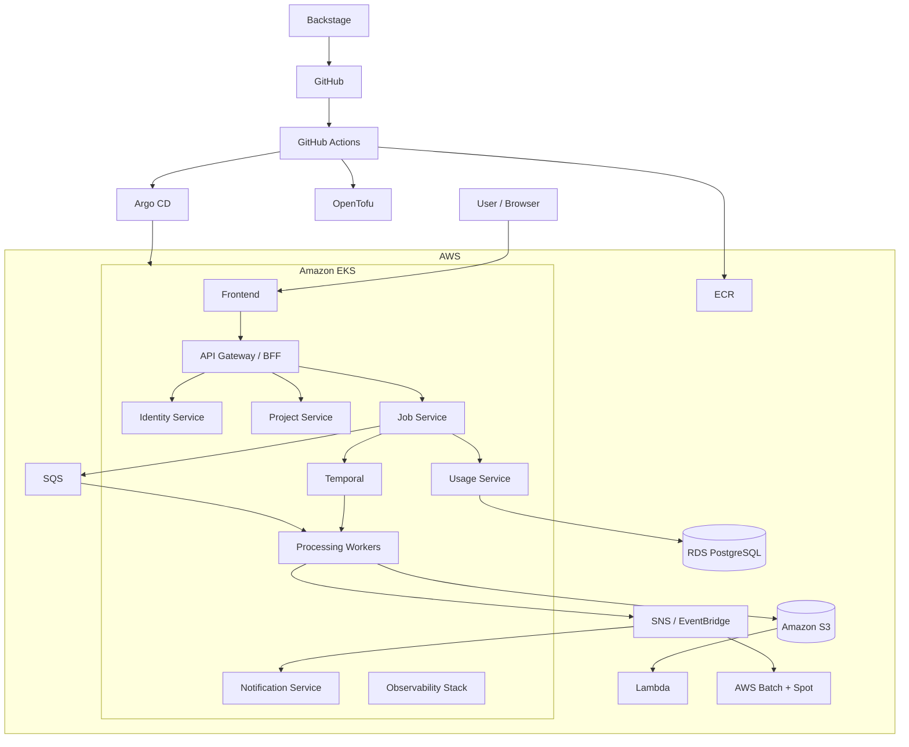

# CloudForge

**A production-grade cloud-native media processing platform and internal developer platform, built on AWS, Kubernetes, OpenTofu, GitHub Actions, and Argo CD.**

> Portfolio project focused on DevOps, Platform Engineering, SRE, Cloud Infrastructure, GitOps, and Distributed Systems.

[]()
[]()
[]()
[]()
[]()

---

## Table of Contents

- [Project Overview](#project-overview)
- [Goals and Learning Objectives](#goals-and-learning-objectives)
- [Application Overview](#application-overview)
- [Architecture](#architecture)
- [Technology Stack](#technology-stack)
- [Application Services](#application-services)
- [AWS Infrastructure](#aws-infrastructure)
- [Infrastructure as Code](#infrastructure-as-code)
- [CI/CD and GitOps](#cicd-and-gitops)
- [Environments](#environments)
- [Internal Developer Platform](#internal-developer-platform)
- [Preview Environments](#preview-environments)
- [Progressive Delivery](#progressive-delivery)
- [Observability](#observability)
- [Reliability Engineering](#reliability-engineering)
- [Disaster Recovery](#disaster-recovery)
- [Performance Engineering](#performance-engineering)
- [Security](#security)
- [FinOps](#finops)
- [Testing Strategy](#testing-strategy)
- [Engineering Workflow](#engineering-workflow)
- [Repository Structure](#repository-structure)
- [Local Development](#local-development)
- [Implementation Roadmap](#implementation-roadmap)
- [Portfolio Demonstrations](#portfolio-demonstrations)
- [Documentation](#documentation)
- [Project Status](#project-status)

---

## Project Overview

CloudForge is a multi-tenant, asynchronous media-processing SaaS platform running on AWS.

Users can upload images, configure processing workflows, monitor jobs, and download processed results.

The application is intentionally kept relatively simple. The primary focus is building and operating a sophisticated cloud platform around it.

CloudForge combines two projects:

1. **A realistic SaaS application** built with microservices, asynchronous processing, object storage, and serverless workloads.
2. **An internal developer platform** that automates infrastructure provisioning, service creation, deployments, observability, security, testing, and operational workflows.

The platform aims to demonstrate how a developer can go from an idea to a deployed, observable, secure, tested, and cost-aware service with minimal manual intervention.

### Core principles

- Infrastructure as Code for all AWS infrastructure.
- GitOps as the source of truth for Kubernetes deployments.
- Immutable artifacts promoted between environments.
- Automated security and quality gates.
- Self-service developer workflows.
- Observable and measurable reliability.
- Resilience to infrastructure and application failures.
- Cost-aware infrastructure and workload design.
- Reproducible environments and automated recovery.
- Practical engineering tradeoffs instead of technology for technology's sake.

## Goals and Learning Objectives

The project is designed to provide hands-on experience with:

### Cloud and Infrastructure

- AWS networking, IAM, security, and managed services.
- Kubernetes architecture and operations.
- Infrastructure provisioning using OpenTofu.
- Multi-environment and multi-account infrastructure.
- Infrastructure lifecycle management and upgrades.

### DevOps and Platform Engineering

- CI/CD pipelines and reusable workflows.
- GitOps with Argo CD.
- Progressive delivery with Argo Rollouts.
- Internal developer portals and golden paths.
- Ephemeral environments.
- Platform APIs and self-service automation.

### SRE and Reliability

- Metrics, logs, traces, and alerting.
- SLOs, SLIs, and error budgets.
- Incident response and postmortems.
- Chaos engineering.
- Disaster recovery and backup restoration.
- Performance and capacity engineering.

### Security and Governance

- Workload identity and least-privilege IAM.
- Supply-chain security.
- Container and infrastructure scanning.
- Kubernetes policy enforcement.
- Secrets management.
- Multi-tenant isolation and auditability.

### Cost Optimization

- Spot capacity and autoscaling.
- Scale-to-zero workloads.
- Automated environment cleanup.
- Cost attribution.
- Cost-per-workload analysis.
- Infrastructure cost estimation.

---

## Application Overview

CloudForge provides an asynchronous image-processing platform.

### User functionality

- User registration and authentication.
- Organizations and project management.
- Image uploads using presigned S3 URLs.
- Configurable processing workflows.
- Image resizing, compression, format conversion, and thumbnail generation.
- Image metadata extraction.
- Processing job status and history.
- Downloadable processing results.
- Project-level storage and processing quotas.
- Usage statistics and reports.
- Notifications and webhooks.
- API key management.

### Example workflow

1. A user creates a processing job.
2. The browser uploads an image directly to S3.
3. The Job Service validates the request and creates a job.
4. A durable workflow is initiated.
5. Workers process the image.
6. Results are stored in S3.
7. Job status and usage information are updated.
8. Notifications are delivered.
9. The user downloads the result.

The workflow should support retries, timeouts, idempotency, partial failure recovery, and durable execution.

---

## Architecture

### High-level architecture



### Platform layers

| Layer | Components |
|---|---|
| Developer Experience | Backstage, service catalog, golden paths, preview environments |
| Delivery | GitHub Actions, OpenTofu, Argo CD, Argo Rollouts |
| Application | SvelteKit, Go services, Python workers, Temporal |
| Cloud | AWS, EKS, RDS, S3, SQS, SNS, Lambda, AWS Batch |
| Observability | OpenTelemetry, Prometheus, Grafana, Loki, Tempo |
| Reliability | SLOs, chaos engineering, DR, load testing |
| Security | IAM, Kyverno, Secrets Manager, supply-chain security |
| FinOps | Infracost, OpenCost, AWS Budgets, cost dashboards |

---

## Technology Stack

### Application

| Component | Technology |
|---|---|
| Frontend | SvelteKit, TypeScript |
| API services | Go |
| Processing workers | Python |
| Workflow orchestration | Temporal |
| API contracts | OpenAPI, AsyncAPI |
| Database | PostgreSQL |
| Cache | Redis / Valkey |
| Object storage | Amazon S3 |
| Messaging | Amazon SQS, SNS, EventBridge |
| Serverless processing | AWS Lambda |
| Batch processing | AWS Batch with Spot capacity |

### Cloud and Infrastructure

| Component | Technology |
|---|---|
| Cloud provider | AWS |
| Kubernetes | Amazon EKS |
| Infrastructure as Code | OpenTofu |
| Container registry | Amazon ECR |
| Networking | AWS VPC |
| DNS | Route 53 |
| TLS | AWS ACM |
| Ingress | AWS Load Balancer Controller |
| Node provisioning | Karpenter |
| Workload autoscaling | HPA, KEDA |
| Secrets | AWS Secrets Manager |
| Encryption | AWS KMS |
| Backup | AWS Backup, RDS snapshots |

### Delivery and Developer Platform

| Component | Technology |
|---|---|
| CI | GitHub Actions |
| GitOps | Argo CD |
| Progressive delivery | Argo Rollouts |
| Kubernetes packaging | Helm, Kustomize |
| Developer portal | Backstage |
| Dependency automation | Renovate |
| Feature flags | OpenFeature, Unleash |
| Ticketing | GitHub Issues and Projects |
| Documentation | Markdown, ADRs, Backstage TechDocs |

### Observability and Reliability

| Component | Technology |
|---|---|
| Instrumentation | OpenTelemetry |
| Metrics | Prometheus |
| Dashboards | Grafana |
| Logs | Loki |
| Traces | Tempo |
| Alerting | Alertmanager |
| Load testing | k6 |
| Chaos engineering | LitmusChaos, AWS Fault Injection Service |
| Cost monitoring | OpenCost, AWS Cost Explorer |

### Security

| Component | Technology |
|---|---|
| SAST | CodeQL, Semgrep |
| Secret scanning | Gitleaks |
| Container scanning | Trivy |
| IaC scanning | Checkov |
| SBOM | Syft |
| Image signing | Cosign |
| Kubernetes policies | Kyverno |
| Runtime security | Falco / AWS GuardDuty |
| AWS audit | CloudTrail, AWS Config |
| Identity | GitHub OIDC, EKS Pod Identity |

---

## Application Services

### Identity Service

- User registration and profiles.
- Organizations and memberships.
- Authentication and authorization.
- API key management.
- Role-based access control.

### Project Service

- Project creation and management.
- Processing configuration.
- Project-level quotas.
- Storage settings.
- Tenant configuration.

### Job Service

- Job submission and validation.
- Job state management.
- Workflow initiation.
- Idempotency.
- Retry and cancellation requests.
- Job history and status API.

### Processing Worker

- Image resizing and conversion.
- Compression.
- Thumbnail generation.
- Metadata extraction.
- Quality analysis.
- S3 input/output handling.

### Notification Service

- Email notifications.
- Webhooks.
- Job completion events.
- Retry and delivery tracking.

### Usage Service

- Processing usage metering.
- Storage usage tracking.
- Tenant-level statistics.
- Daily and monthly reports.
- Cost attribution.

### Admin Service

- Platform administration.
- Tenant management.
- Operational controls.
- Job inspection and recovery tools.

### Temporal Workflows

Temporal coordinates long-running processing workflows.

Example workflow:

```text
Validate Upload
      |
      v
Extract Metadata
      |
      v
Generate Variants
      |
      v
Run Quality Analysis
      |
      v
Store Results
      |
      v
Update Job State
      |
      v
Record Usage
      |
      v
Send Notifications
```

Temporal handles durable workflow execution, retries, timeouts, and recovery.

SQS remains responsible for independent event-driven workloads and queue-based worker processing.

### Data ownership

Each service owns its data model and persistence boundaries.

- PostgreSQL for transactional application data.
- S3 for original files, processed outputs, and reports.
- SQS for asynchronous work delivery.
- SNS/EventBridge for event distribution.
- Temporal persistence for workflow state.
- Redis/Valkey for caching and rate limiting.
- DynamoDB where lightweight serverless state or idempotency storage is justified.

The architecture should avoid unrestricted shared database access between microservices.

---

## AWS Infrastructure

### Networking

- VPC spanning three Availability Zones.
- Public subnets for load balancers.
- Private subnets for EKS workloads.
- Isolated subnets for databases.
- NAT gateways or a cost-optimized NAT architecture.
- VPC endpoints for S3, ECR, SQS, STS, Secrets Manager, and other supported services.
- Security Groups with least-privilege rules.
- Route 53 DNS.
- ACM-managed TLS certificates.

### Amazon EKS

- Managed Kubernetes control plane.
- Karpenter-managed EC2 capacity.
- Separate capacity pools for system workloads, applications, and workers.
- Spot instances for interruptible workloads.
- On-demand instances for critical services.
- HPA for API services.
- KEDA for queue-driven workers.
- Pod disruption budgets.
- Resource requests and limits.
- Topology spread constraints.
- Network policies.
- Pod Security Standards.

### AWS Managed Services

| Service | Purpose |
|---|---|
| EKS | Kubernetes platform |
| RDS PostgreSQL | Application persistence |
| S3 | File and artifact storage |
| SQS | Asynchronous queues |
| SNS | Event fan-out |
| EventBridge | Scheduled and event-driven automation |
| Lambda | Short event-driven compute |
| AWS Batch | Heavy asynchronous compute |
| ECR | Container registry |
| Secrets Manager | Application secrets |
| KMS | Encryption |
| CloudTrail | AWS audit trail |
| AWS Config | Configuration compliance |
| GuardDuty | Threat detection |
| AWS Backup | Backup policies |
| DynamoDB | Optional serverless state |

### S3 Features

- Versioning.
- Encryption.
- Lifecycle policies.
- Intelligent-Tiering.
- Presigned uploads and downloads.
- Object access controls.
- Access logging.
- Retention policies.
- Event notifications.
- Optional cross-region replication.

### Lambda Workloads

- Image metadata extraction.
- Daily analytics aggregation.
- Temporary object cleanup.
- Usage report generation.
- Audit event processing.

### AWS Batch + Spot

Heavy or non-urgent workloads run through AWS Batch:

- Large-scale image analysis.
- Image similarity indexing.
- Bulk thumbnail regeneration.
- Monthly report generation.
- Reprocessing historical files.

Features:

- Spot capacity.
- Retry policies.
- Job timeouts.
- Checkpointing.
- Queue priorities.
- Separate compute environments.
- Optional on-demand fallback.

Lambda is used for short event-driven workloads; AWS Batch handles longer-running and resource-intensive compute.

---

## Infrastructure as Code

OpenTofu manages AWS infrastructure.

### Module structure

- VPC.
- EKS.
- RDS.
- S3.
- IAM.
- ECR.
- SQS/SNS.
- Lambda.
- AWS Batch.
- Observability infrastructure.
- Security policies.

### State management

- S3 remote state.
- State locking.
- KMS encryption.
- State versioning.
- Separate states per environment and infrastructure layer.
- Restricted state access.
- CI-generated plans.
- Reviewed infrastructure changes.
- Documented bootstrap process.

### Infrastructure CI

Pull requests run:

- `tofu fmt`
- `tofu validate`
- TFLint
- Checkov
- Infracost
- Plan generation
- Policy validation

Infrastructure changes require review before applying.

---

## CI/CD and GitOps

### Application Pipeline

```text
Pull Request
    |
    v
Lint + Unit Tests
    |
    v
Integration + Contract Tests
    |
    v
Security + Dependency Scans
    |
    v
Build Container
    |
    v
Generate SBOM
    |
    v
Scan + Sign Image
    |
    v
Push to ECR
    |
    v
Update GitOps Configuration
    |
    v
Argo CD Reconciliation
```

### GitHub Actions

- Reusable workflows.
- Composite actions.
- Service-specific workflow matrices.
- Path-based build optimization.
- OIDC authentication to AWS.
- GitHub Environments.
- Deployment protection rules.
- Concurrency controls.
- Build caching.
- SBOM generation.
- Image signing.
- Vulnerability scanning.
- Automated release notes.
- Scheduled security scans.
- Renovate dependency updates.

### GitOps Responsibilities

GitHub Actions builds and publishes immutable artifacts.

Argo CD reconciles Kubernetes deployments from Git.

Application deployment workflows should not directly modify live Kubernetes resources.

### Release Promotion

1. Merge to main.
2. Build and publish an immutable image digest.
3. Update staging configuration.
4. Argo CD deploys staging.
5. Run smoke, integration, and performance tests.
6. Promote the same digest to production.
7. Argo Rollouts performs a canary deployment.
8. Automated analysis determines promotion or rollback.

---

## Environments

### Staging

- Non-production AWS account.
- Small EKS cluster.
- Cost-optimized capacity.
- Synthetic data.
- Automated deployments.
- Integration and performance testing.
- Automated cleanup where possible.

### Production

- Separate AWS account.
- High-availability infrastructure.
- Multi-AZ RDS.
- Restricted access.
- Production deployment approvals.
- Canary releases.
- Longer backup retention.
- Full monitoring and alerting.

### Environment Promotion

```text
Feature Branch
      |
      v
Pull Request
      |
      v
Preview Environment
      |
      v
Staging
      |
      v
Release Candidate
      |
      v
Production Approval
      |
      v
Canary Deployment
      |
      v
Full Production Release
```

The same immutable artifact is promoted between environments.

---

## Internal Developer Platform

Backstage provides a self-service developer portal.

### Service Catalog

Each service includes:

- Repository and owner.
- API documentation.
- Dependencies.
- Deployment environments.
- Grafana dashboards.
- Logs and traces.
- SLOs and alerts.
- Runbooks.
- Release history.
- Security status.

### Golden Paths

Templates for:

- Go microservices.
- Python workers.
- Lambda functions.
- Helm applications.
- OpenTofu modules.
- Scheduled jobs.

Templates automatically generate:

- Repository structure.
- Dockerfile.
- CI workflows.
- Unit and integration tests.
- OpenTelemetry instrumentation.
- Kubernetes manifests.
- Argo CD registration.
- Service catalog metadata.
- Default dashboards and alerts.
- Security scanning.

### Platform API

Provide self-service operations for:

- Creating preview environments.
- Scaffolding services.
- Triggering performance tests.
- Starting DR exercises.
- Inspecting deployment status.
- Viewing costs and quotas.

---

## Preview Environments

Every pull request can create a temporary environment.

Features:

- Isolated Kubernetes namespace.
- Unique hostname.
- Temporary configuration.
- Synthetic data.
- Resource quotas.
- Automated integration tests.
- PR comment with URL and results.
- TTL-based cleanup.
- Automatic destruction after merge or closure.

Preview environments initially share the staging cluster to control costs.

---

## Progressive Delivery

Argo Rollouts provides canary and blue/green deployments.

### Canary Workflow

1. Deploy the new version.
2. Send a small percentage of traffic.
3. Evaluate latency, error rate, and saturation.
4. Gradually increase traffic.
5. Promote if healthy.
6. Abort and roll back if unhealthy.

Additional features:

- Manual promotion gates.
- Automated rollback.
- Deployment windows.
- Feature flags using OpenFeature and Unleash.
- Database migration compatibility checks.
- Expand-and-contract schema migrations.

---

## Observability

### Metrics

Prometheus and Grafana monitor:

- Request rate.
- Error rate.
- Latency percentiles.
- CPU and memory.
- Pod restarts.
- Queue depth.
- Job processing duration.
- Worker failures and retries.
- Database performance.
- S3 usage.
- Cost per processed image.

### Logs

Loki provides:

- Structured JSON logs.
- Correlation IDs.
- Trace IDs.
- Centralized Kubernetes logs.
- Retention policies.
- Sensitive-data redaction.

### Tracing

OpenTelemetry and Tempo provide:

- Request tracing.
- Service-to-service spans.
- Database spans.
- SQS producer/consumer traces.
- Lambda traces.
- Asynchronous trace propagation.

### Alerting

Alertmanager handles:

- Elevated error rates.
- High latency.
- Queue backlog growth.
- Worker failures.
- Database storage pressure.
- Pod crash loops.
- Node capacity exhaustion.
- Certificate expiration.
- Failed deployments.

### SLOs

Initial example targets:

| Service | SLO |
|---|---|
| API availability | 99.9% |
| API latency | p95 below 300 ms |
| Job acceptance | 99.9% |
| Processing completion | 95% within 5 minutes |
| Notifications | 95% within 1 minute |

SLOs are tracked through dashboards and error-budget policies.

---

## Reliability Engineering

### Chaos Engineering

Use LitmusChaos and AWS Fault Injection Service.

Experiments include:

- Killing worker pods.
- Interrupting Spot instances.
- Injecting API latency.
- Breaking downstream dependencies.
- Simulating database connection exhaustion.
- Exhausting worker capacity.
- Simulating Availability Zone impairment.
- Triggering failed deployments.

Every experiment includes:

- Hypothesis.
- Blast-radius limits.
- Abort conditions.
- Observability links.
- Measurable results.
- Remediation or learning.

### Incident Management

- Alerts create incident issues.
- Incidents include dashboards and runbooks.
- Recovery actions are documented.
- Incident resolution is tracked.
- Blameless postmortems are produced.
- Follow-up actions become engineering tickets.

---

## Disaster Recovery

### Recovery Capabilities

- RDS point-in-time recovery.
- S3 object version recovery.
- EKS cluster reconstruction.
- Infrastructure reconstruction through OpenTofu.
- GitOps recovery from Git.
- Backup integrity verification.
- Optional cross-region recovery.

### DR Metrics

Document and measure:

- Recovery Time Objective (RTO).
- Recovery Point Objective (RPO).
- Actual recovery time.
- Data loss observed.
- Manual intervention required.

Disaster recovery exercises should be regularly tested in non-production.

---

## Performance Engineering

Use k6 for load testing.

### Test Scenarios

- API throughput.
- Job submission throughput.
- Worker processing throughput.
- SQS backlog recovery.
- Database query performance.
- Autoscaling behavior.
- End-to-end workflow latency.
- Soak tests.
- Resource exhaustion tests.

### Performance CI

Staging releases run:

- Smoke tests.
- Short load tests.
- Latency and throughput comparisons.
- Regression thresholds.
- Benchmark artifact storage.

Key experiment:

> Can CloudForge process 10,000 image jobs while maintaining a p95 completion time below five minutes, and what is the cost?

---

## Security

### Source and Supply Chain

- CodeQL.
- Semgrep.
- Gitleaks.
- Renovate.
- Trivy.
- Syft SBOM generation.
- Cosign image signing.
- SLSA provenance.
- Automated dependency updates.

### Kubernetes

- Kyverno policies.
- Pod Security Standards.
- NetworkPolicies.
- Non-root containers.
- Read-only filesystems.
- Dropped Linux capabilities.
- Resource limits.
- Least-privilege RBAC.
- Signed image verification.

### AWS

- GitHub OIDC.
- EKS Pod Identity.
- IAM least privilege.
- AWS Secrets Manager.
- External Secrets Operator.
- KMS encryption.
- CloudTrail.
- AWS Config.
- GuardDuty.
- IAM Access Analyzer.

### Application Security

- Multi-tenant authorization tests.
- Tenant-scoped API keys.
- Per-tenant quotas.
- S3 access isolation.
- Audit logs.
- Threat modeling.
- Security incident runbooks.
- Automated secret rotation.

Optional advanced extension: Istio for workload mTLS and service-level traffic policies.

---

## FinOps

Cost optimization is part of the platform design.

### Tools

- AWS Budgets.
- AWS Cost Explorer.
- Infracost.
- OpenCost.
- Grafana cost dashboards.
- AWS Cost and Usage Reports.

### Cost Optimization

- Scheduled staging shutdown.
- Automated preview cleanup.
- Spot instances for workers.
- Scale-to-zero workloads.
- S3 lifecycle transitions.
- RDS sizing experiments.
- Cost attribution per tenant.
- Cost per successful workflow.
- Budget alerts.
- Cost anomaly detection.

Key metric:

**Cost per 1,000 successfully processed images**, broken down by compute, storage, database, and networking.

---

## Testing Strategy

### Application Testing

- Unit tests.
- Integration tests.
- API contract tests.
- End-to-end tests.
- Database migration tests.
- Idempotency tests.
- Authorization tests.
- Workflow recovery tests.

### Infrastructure Testing

- OpenTofu validation.
- Static analysis.
- Policy validation.
- Infrastructure integration tests.
- Kubernetes manifest validation.
- Helm linting.
- Deployment smoke tests.

### Platform Testing

- Service template validation.
- Preview environment lifecycle tests.
- GitOps reconciliation tests.
- Canary rollback tests.
- Autoscaling tests.
- Chaos experiments.
- DR exercises.
- Cost policy validation.

---

## Engineering Workflow

GitHub Issues and Projects provide ticketing and planning.

### Feature Workflow

1. Create an issue.
2. Create a branch.
3. Open a pull request.
4. Run CI checks.
5. Create a preview environment.
6. Review and merge.
7. Deploy to staging.
8. Validate the release.
9. Promote to production.
10. Record deployment status and release notes.

### Automated Operational Tickets

- Production alerts create incident issues.
- Failed deployments annotate related issues.
- Dependency updates create PRs.
- Certificate expiration creates maintenance tickets.
- Security findings create remediation issues.
- Postmortem actions become tracked work.

---

## Repository Structure

```text
cloudforge/
├── apps/
│   ├── frontend/
│   ├── api-gateway/
│   ├── identity-service/
│   ├── project-service/
│   ├── job-service/
│   ├── worker/
│   ├── notification-service/
│   ├── usage-service/
│   └── admin-service/
├── lambda/
│   ├── analytics/
│   ├── cleanup/
│   └── metadata/
├── batch/
│   └── image-analysis/
├── infra/
│   ├── modules/
│   │   ├── vpc/
│   │   ├── eks/
│   │   ├── rds/
│   │   ├── s3/
│   │   ├── iam/
│   │   ├── messaging/
│   │   └── observability/
│   └── environments/
│       ├── staging/
│       └── production/
├── platform/
│   ├── bootstrap/
│   ├── argocd/
│   ├── addons/
│   ├── policies/
│   └── backstage/
├── deploy/
│   ├── base/
│   └── overlays/
│       ├── staging/
│       └── production/
├── templates/
│   ├── go-service/
│   ├── python-worker/
│   ├── lambda/
│   └── tofu-module/
├── tests/
│   ├── integration/
│   ├── e2e/
│   ├── performance/
│   └── chaos/
├── docs/
│   ├── architecture/
│   ├── adr/
│   ├── runbooks/
│   ├── incident-reviews/
│   ├── disaster-recovery/
│   └── security/
├── .github/
│   └── workflows/
├── Makefile
└── README.md
```

---

## Local Development

Local development should not require an AWS account.

Use:

- Docker Compose.
- PostgreSQL.
- LocalStack where useful for AWS service emulation.
- Local application services.
- Local Temporal development environment.
- Make targets.
- Devcontainers.

Example commands:

```bash
make dev
make test
make lint
make build
make integration-test
make infra-validate
```

Cloud-specific behavior should also be validated in a real AWS staging environment because local emulation does not guarantee production equivalence.

---

## Implementation Roadmap

| Phase | Deliverable |
|---|---|
| 1 | Application, microservices, local development, tests |
| 2 | AWS foundation, OpenTofu, EKS, staging |
| 3 | GitHub Actions, ECR, Argo CD, production |
| 4 | S3, SQS, Lambda, Temporal, AWS Batch |
| 5 | Observability, SLOs, alerts, runbooks |
| 6 | Backstage, golden paths, service catalog |
| 7 | Preview environments and automated cleanup |
| 8 | Argo Rollouts, canary analysis, feature flags |
| 9 | Security policies and supply-chain controls |
| 10 | Performance testing and autoscaling experiments |
| 11 | Chaos engineering and incident workflows |
| 12 | Disaster recovery and restoration exercises |
| 13 | FinOps and cost dashboards |
| 14 | Platform upgrades and advanced networking |
| 15 | Service mesh and advanced platform automation |

Each phase should leave the platform deployable, documented, and demonstrable.

---

## Portfolio Demonstrations

The project should include recorded demonstrations of:

### Developer Experience

- Creating a new service through Backstage.
- Automatically generating its repository and CI pipeline.
- Deploying a preview environment from a pull request.

### Delivery

- Promoting an immutable artifact from staging to production.
- Performing a canary deployment.
- Triggering automated rollback after a bad release.

### Reliability

- Interrupting a Spot worker and recovering its jobs.
- Scaling workers based on SQS backlog.
- Running a chaos experiment and measuring recovery.

### Operations

- Investigating a distributed trace.
- Responding to a simulated incident.
- Executing a disaster recovery exercise.

### FinOps

- Comparing always-on and autoscaled workers.
- Measuring cost per processed image.
- Demonstrating automated cleanup of temporary infrastructure.

---

## Documentation

The repository should include:

- Architecture diagrams.
- Infrastructure diagrams.
- CI/CD and GitOps diagrams.
- Architecture Decision Records (ADRs).
- Service documentation.
- API specifications.
- Runbooks.
- SLO definitions.
- Incident postmortems.
- Disaster recovery procedures.
- Security and threat models.
- Cost analysis.
- Performance benchmarks.
- Upgrade procedures.

---

## Project Status

CloudForge is an evolving portfolio and learning project.

The intended outcome is a fully automated, observable, secure, reliable, and cost-aware cloud platform demonstrating practical skills in:

- DevOps Engineering.
- Platform Engineering.
- Cloud Infrastructure.
- Kubernetes Operations.
- Site Reliability Engineering.
- Infrastructure as Code.
- GitOps and CI/CD.
- Security Engineering.
- Distributed Systems.
- FinOps.

**The goal is not simply to deploy an application to Kubernetes. The goal is to build a platform where deploying, operating, securing, scaling, testing, and recovering applications are automated and measurable.**

---

## License

TBD.

